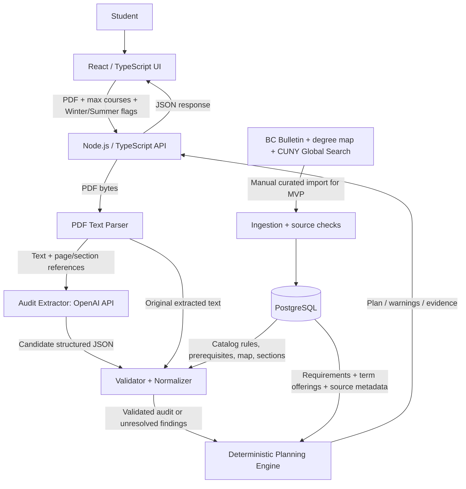

# DegreePilot — Architecture & MVP Specification

**Version:** 0.1 (draft)  
**Date:** 2026-11-07  
**Initial target:** Brooklyn College, **B.S. in Computer Science only**  
**Status:** Design document; not an official Brooklyn College or Ellucian product

## 1. Product in one sentence

A Brooklyn College B.S. Computer Science student uploads a **DegreeWorks PDF**, specifies **maximum courses per term**, and chooses whether to include **Winter and/or Summer**; DegreePilot extracts the outstanding requirements, checks them against a curated academic dataset, and returns a **semester-by-semester proposed plan with clear verification labels**.

> **Primary objective:** Earliest feasible completion based on verified requirements and the data we have. Never equate a proposed plan with guaranteed graduation or registration eligibility.

## 2. MVP boundary

### Only three student inputs

1. **DegreeWorks PDF** (required).
2. **Maximum courses per term**: one integer, **1–4** for MVP (required, default 4). The limit applies to every selected term; actual Winter/Summer credit restrictions must also be respected if known.
3. **Include Winter** and **Include Summer**: two independent checkboxes (default unchecked). Fall and Spring are always included.

No account, chat interface, major picker, online-only setting, work schedule, GPA input, transfer search, or manual course selection in v0.1. The intended major is inferred and checked against the uploaded audit; other programs are unsupported.

### In scope

- Upload and parse a digitally generated DegreeWorks PDF.
- Extract program/catalog year (when present), completed/in-progress courses, remaining requirements, alternatives, and credit shortfalls.
- Use one official **Brooklyn College Computer Science B.S. degree map** as an **advisory sequence**, alongside applicable Bulletin/course rules.
- Store curated CISC courses, prerequisites, course alternatives, permission flags, and a **small manually verified set of semester offerings** from CUNY Global Search.
- Detect unsupported or ambiguous requirements and **refuse to certify** them.
- Generate course-by-term suggestions using the allowed terms and maximum course count.
- Label each recommended course as **published/verified**, **projected**, or **unknown** based on section evidence; show risks and sources.
- A single read-only results screen; no registration or DegreeWorks account access.

### Out of scope for v0.1

- Other majors or colleges, T-Rex, ePermit/transfer optimization, automatic registration, live CUNYfirst/degree-audit integration.
- Automated scraping or a purported official CUNY API (not established).
- Professor preferences, detailed daily time conflicts, user-defined online preference, custom overloads, financial aid calculations, full admissions/curricular exception handling.
- Scanned PDFs requiring OCR, accounts, public student-document storage, billing, multi-user accounts.

### Important graduation limitation

A B.S. **major map and CISC catalog are not enough to validate every graduation requirement**: an audit may include Pathways, College Option, non-CISC math/science requirements, minimum credits, residency, exceptions, or substitutions. The audit remains our student-specific starting point. We will either:

- model a remaining non-CISC requirement with sufficiently verified data; **or**
- label it `UNRESOLVED` and report **"major-course plan only / graduation date cannot be verified"**.

**Never claim an earliest graduation term unless every applicable remaining requirement is accounted for.** The app can still show a useful *partial* plan.

## 3. Architecture decisions (ADRs)

| ID | Decision | Reason |
|---|---|---|
| ADR-001 | React + TypeScript frontend | Familiar, maintainable UI. |
| ADR-002 | One Node.js + TypeScript backend (monolith) | One deployable API; simpler than microservices. |
| ADR-003 | OpenAI API is used **only for structured audit extraction** in MVP | LLMs are useful at interpreting variable PDF wording, **not** for enforcing academic rules. |
| ADR-004 | Deterministic validator + scheduler | Requirements, limits, and prerequisite ordering must be testable. |
| ADR-005 | PostgreSQL for the deployed data source; small JSON fixtures for earliest local testing | Reliable relational queries, migration path, simple learning progression. |
| ADR-006 | Official rules and verified course sections have provenance and freshness metadata | Prevents outdated or hypothetical offerings from looking confirmed. |
| ADR-007 | Review ambiguous extraction internally; return warnings rather than invent facts | Safety and accuracy over a confident but wrong result. |
| ADR-008 | No student login to DegreeWorks, no T-Rex, no official affiliation claim | Narrow scope and reduce access/security complexity. |

## 4. Component diagram



**Key idea:** The backend orchestrates the whole request. The database is the *information store*; the validator and scheduler are *code running in the backend*, not independent AI models.

## 5. One-request sequence (CISC 4900 example)

```mermaid
sequenceDiagram
    actor Student
    participant Web as React frontend
    participant API as Node API
    participant PDF as PDF parser
    participant LLM as OpenAI model
    participant DB as PostgreSQL
    participant Engine as Validator + planner

    Student->>Web: Upload audit; max=4; Summer=on; Winter=off
    Web->>API: POST /api/audits (multipart form)
    API->>PDF: extractText(pdf)
    PDF-->>API: text + source locations
    API->>LLM: extract requirements as schema-constrained JSON
    LLM-->>API: candidate: remaining CISC 4900, etc.
    API->>DB: load applicable catalog rules, map, course offerings
    DB-->>API: versioned verified facts + freshness
    API->>Engine: validate candidate against raw text, rules, student history
    Engine-->>API: normalized audit + unknown/ambiguous flags
    API->>Engine: optimize validated requirements by permitted terms
    Engine-->>API: proposed plan + evidence + warnings
    API-->>Web: JSON result
    Web-->>Student: Semester timeline and verification badges
```

**Illustrative only:** No actual CISC 4900 prerequisite, credit value, semester offering, or permission rule is asserted by this diagram; those must be imported and verified from sources applicable to the student.

## 6. Phase-by-phase behavior (action → response)

| Phase | Component | Action | Output / failure |
|---|---|---|---|
| 1 | React | Check PDF supplied, valid count 1–4, read checkboxes; upload via `multipart/form-data`. | Upload accepted or input error. |
| 2 | API | Check file type, size, authorization/rate limit; assign request ID. | Safe request context or `400/413/429`. |
| 3 | PDF parser | Extract text from born-digital PDF; retain snippet references. | Plain text + references; `unsupported_pdf` if unreadable. |
| 4 | LLM extractor | Extract **candidate** degree/program, courses, requirement groups, counts, statuses, source quotes to strict JSON schema. | JSON or `extraction_failed`; **never a finished plan**. |
| 5 | Validator | Validate schema, corroborate quoted excerpts, confirm supported CS program, normalize IDs, match catalog-year rules and previously completed/in-progress courses. | `validated`, `needs_review`, or `unsupported_program`. |
| 6 | DB repository | Return CISC catalog, non-CISC rules we support, prerequisites, alternatives, degree-map order, and published/historical term offerings with source dates. | Dated source records; `missing_data` if incomplete. |
| 7 | Planning engine | Generate all supported eligible course choices and term assignments, observe prerequisite ordering and max-count; prefer earliest completion. | Feasible plan, conditional projection, or `no_verified_plan`. |
| 8 | API + React | Serialize results with caveats, source references, and unknowns. | Semester timeline, `provisional`/`partial` status; never a false guarantee. |

### Example (hypothetical)

- Audit excerpt: `Still needed: CISC 4900` (student program is Computer Science B.S.).
- LLM candidate: `{ "type": "specific_course", "courseId": "CISC 4900", "status": "remaining", "evidence": "Still needed: CISC 4900" }`.
- Backend: verify audit evidence and whether relevant catalog rules accept the extracted requirement or a choice group (e.g., `CISC 4900 OR ...`); do not erase alternatives.
- DB: retrieve catalog-year course rules, prerequisites and section records **if they exist**.
- Planner: if prerequisite/permission is unknown, **mark conditional or block verified enrollment**; if a future section is based only on historical offerings, **label it projected**.
- UI: `CISC 4900 — suggested term: conditional / availability projected; verify permission and section publication`.

## 7. Source-of-truth and data acquisition

**Authority hierarchy:**

1. **Student's current DegreeWorks audit**: student-specific progress, completed courses, exceptions, outstanding blocks. Record audit issue date; it may not be instantly up to date.
2. **Applicable Brooklyn College Bulletin + department rules**: formal curriculum, catalog-year variations, prerequisites, minimum grades, permissions, exceptions.
3. **B.S. Computer Science degree map (one version)**: **recommended order**, not definitive rules or a personalized plan; the map does not cover optional Winter/Summer.
4. **CUNY Global Search**: semester-specific sections/modes when published; historic semesters inform predictions **only**.

For v0.1, the academic dataset is **curated manually**, reviewed and seeded into the database. We do *not* promise real-time synchronization or a public CUNY API. Every fact should have `sourceUrl`, `sourceRetrievedAt`, and `effectiveCatalogYear` (where applicable).

**Freshness semantics:**

- `PUBLISHED`: official listing found for the **target** term, checked as of a specified timestamp (still subject to changes and seats).
- `PROJECTED`: based on prior terms/department schedule patterns; **not** available-to-register confirmation.
- `UNKNOWN`: insufficient data to assert a target-term section.

## 8. Conceptual data model

```ts
type Session = "SPRING" | "SUMMER" | "FALL" | "WINTER";
type CourseStatus = "COMPLETED" | "IN_PROGRESS" | "REMAINING";
type OfferingConfidence = "PUBLISHED" | "PROJECTED" | "UNKNOWN";

type UserInput = {
  auditPdf: File;               // browser only; transmitted to API
  maxCoursesPerTerm: 1 | 2 | 3 | 4;
  includeWinter: boolean;
  includeSummer: boolean;
};

type Program = { id: string; college: "Brooklyn College"; degree: "BS"; major: "Computer Science"; catalogYear?: string };
type Course = { id: string; subject: string; number: string; title: string; credits?: number };
type PrerequisiteRule = { courseId: string; expression: unknown; sourceId: string }; // OR / AND / grades / permission; refine schema later

type Requirement = {
  id: string;
  kind: "EXACT_COURSE" | "COURSE_CHOICE" | "CREDIT_GROUP" | "TOTAL_CREDITS" | "UNRESOLVED";
  eligibleCourseIds?: string[];
  creditsRemaining?: number;
  auditEvidence: string;
  status: CourseStatus;
};

type CourseOffering = {
  courseId: string;
  termId: string;
  sectionId?: string;
  mode?: "ONLINE" | "HYBRID" | "IN_PERSON";
  confidence: OfferingConfidence;
  sourceId: string;
  checkedAt: string;
};

type PlanResult = {
  status: "PROVISIONAL" | "PARTIAL" | "NO_VERIFIED_PLAN";
  semesters: { termId: string; courseIds: string[] }[];
  earliestCompletionTerm?: string; // only if all requirements are modeled
  unresolvedRequirements: string[];
  warnings: string[];
};
```

### Initial database tables

| Table | Purpose |
|---|---|
| `courses` | One record per actual BC course. |
| `course_rules` | Prerequisites, corequisites, grade/permission requirements, catalog/source versions. |
| `program_requirements` | Computer Science B.S. requirements and allowed alternatives by catalog year. |
| `degree_map_steps` | Suggested sequence for **one** B.S. map. |
| `terms` | Fall/Spring and optionally Winter/Summer, in chronological order. |
| `course_offerings` | Published section snapshots or clearly separated historical observations. |
| `source_records` | Official URL, effective term/year, date checked, reviewer, extraction metadata. |

**No student record persistence is required for the earliest public demo.** Process test PDFs ephemerally; avoid saving raw audits or personally identifying information in application logs. If persistence is later needed, design authentication, access control, encryption, retention and deletion first.

## 9. Backend interface (draft)

### `POST /api/plans/from-audit`

**Request:** `multipart/form-data`: `auditPdf`, `maxCoursesPerTerm`, `includeWinter`, `includeSummer`.

**Behavior:** parse → extract via LLM → validate → load rules/offerings → schedule → return result. For v0.1 one request is simplest; later split into asynchronous upload, review, and plan endpoints if latency or manual review requires it.

**Example response (demonstration only):**

```json
{
  "status": "PARTIAL",
  "program": "Brooklyn College Computer Science BS",
  "semesters": [
    {
      "term": "Fall 2027",
      "courses": [{ "id": "CISC 4900", "offering": "PROJECTED", "eligibility": "NEEDS_REVIEW" }]
    }
  ],
  "earliestCompletionTerm": null,
  "unresolvedRequirements": ["Non-CISC graduation requirement not yet modeled"],
  "warnings": [
    "This is a planning estimate, not an official degree audit.",
    "Fall 2027 section availability has not been confirmed."
  ]
}
```

The application must not convert `NEEDS_REVIEW` or `PROJECTED` into `verified`, and should return errors for unsupported PDFs/programs.

## 10. Scheduling logic

1. Build a normalized requirement graph from validated audit blocks and applicable catalog rules.
2. Remove satisfied requirements; honor course alternatives, in-progress status, credit minima, and rules about reusing courses across blocks.
3. List candidate courses that could satisfy each remaining requirement.
4. Build chronological allowed terms: always Spring/Fall; Winter and Summer only if boxes checked.
5. Load course sections for each term, clearly separating published target-term data from historical projections.
6. Enumerate feasible assignments; hard constraints: prerequisite order, rules/permission, course count ≤ user limit, course cannot be scheduled twice without an explicit repeat policy.
7. **Optimize earliest term of complete satisfaction**, then use a stable tie-break (e.g. fewer projected sections). Do not optimize for online modality because the MVP has **no online preference input**.
8. If some requirements aren't modeled, return a **partial** plan with no guaranteed graduation term.

Early implementation can use backtracking/search over a few courses. Add a formal constraint solver only if complexity justifies it.

## 11. Quality, safety, and testing

### Required safeguards

- Never send the OpenAI API key to the browser.
- Validate file extensions, MIME types, file contents and size; reject encrypted, unreadable, or scanned PDFs in v0.1.
- Enforce upload and API rate limits; prevent unexpected API expenditure.
- Extract the minimum text required; redact names and identifiers from model requests where feasible.
- Treat the PDF and the LLM response as **untrusted inputs**, not instructions; use strict JSON schema, validation, and evidence linkage.
- No silent academic rule invention or undocumented exceptions.
- Show audit/section source date and strong disclaimers about adviser confirmation.
- For public users, conduct a privacy and security review *before* accepting unredacted education records.

### Acceptance tests

- [ ] Valid CS audit and 4-course limit return no term with >4 courses.
- [ ] Excluding Winter/Summer yields only Spring/Fall terms.
- [ ] Enabling Summer changes the plan when a valid earlier Summer option exists.
- [ ] Unmet prerequisites prevent an unconditional course assignment.
- [ ] Department permission marked unknown never becomes approved automatically.
- [ ] An elective choice is preserved as alternatives, not converted to one fixed course.
- [ ] A course offered *last* Fall is not labeled verified for *next* Fall.
- [ ] Unknown Pathways/College Option/credit shortfall yields `PARTIAL`, not a false graduation date.
- [ ] Non-CS major is rejected as unsupported.
- [ ] LLM omitting or fabricating a requirement is caught or flagged by evidence checks where possible.
- [ ] PDF failures return readable errors without saving student-identifying documents.

## 12. Implementation milestones (learning-first)

1. **Architecture review** — student journey, responsibilities, and Mermaid diagrams (this document).
2. **Local setup** — Git repository, TypeScript frontend/backend, sample JSON; no AI key needed yet.
3. **Verified academic seed dataset** — one map, CS rules, small published/historical section snapshot, citations.
4. **Pure TypeScript planner** — build rule checks and scheduling with automated tests, independent of the LLM.
5. **PDF extraction + schema** — convert a *redacted* representative audit into a typed internal model.
6. **OpenAI integration** — replace mocked extractor with actual JSON extraction; test uncertain/malformed cases.
7. **Full user journey** — upload → provisional schedule UI; errors and evidence display.
8. **Database and deployment** — PostgreSQL migrations, controlled hosting, monitoring, privacy gate, final QA.

Each milestone should include: *what problem it solves*, *input/output example*, *tests*, and *what the developer learned*. Target a working demo by December 2026, not an unreviewed public advising service.

## 13. Known risks and open technical questions

1. **Incomplete degree modeling:** one map cannot establish all graduation requirements. How much non-CISC logic can we accurately support in the first demo?
2. **Catalog-year differences and student exceptions:** a single map may not match every student's audit. Need source-aware checks and an explicit unsupported case.
3. **PDF reliability:** layout and hidden text vary; evidence extraction can fail. Start with one representative redacted PDF.
4. **Course data access:** a manual Global Search snapshot is feasible, but automated ingestion needs permission/technical validation.
5. **Future offerings:** cannot equate historical schedule patterns with published sections.
6. **Eligibility details:** minimum grades, co-requisites, departmental approval and residency can block enrollment/degree completion.
7. **Privacy/IP:** student audits are educational records; use Ellucian/CUNY names descriptively and don't imply integration, endorsement, or the right to resell their content/software.

## 14. Verified public references (checked 2026-11-07)

- Brooklyn College degree maps overview: https://www.brooklyn.edu/ssu/degree-maps/
- Brooklyn College B.S. Computer Science program, 2026–27: https://www.brooklyn.edu/academics/programs/computer-science-bs/
- Brooklyn College Computer Science undergraduate resources: https://www.brooklyn.edu/cis/undergraduate-computer-science/
- Brooklyn College Bulletins: https://www.brooklyn.edu/registrar/bulletins/
- CUNY Global Search: https://globalsearch.cuny.edu/
- CUNY Global Search FAQ: https://www.cuny.edu/academics/academic-programs/register-for-a-course/global-search-faq/

**Source caution:** The public degree-map page and program page are authoritative sources for *their published content*, not evidence that the app has obtained or verified every prerequisite, schedule, or exception. Those datasets still have to be built and tested.
